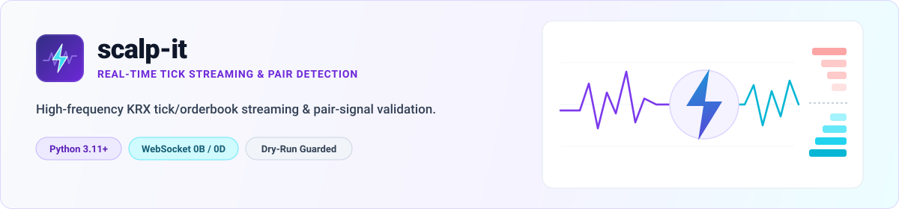
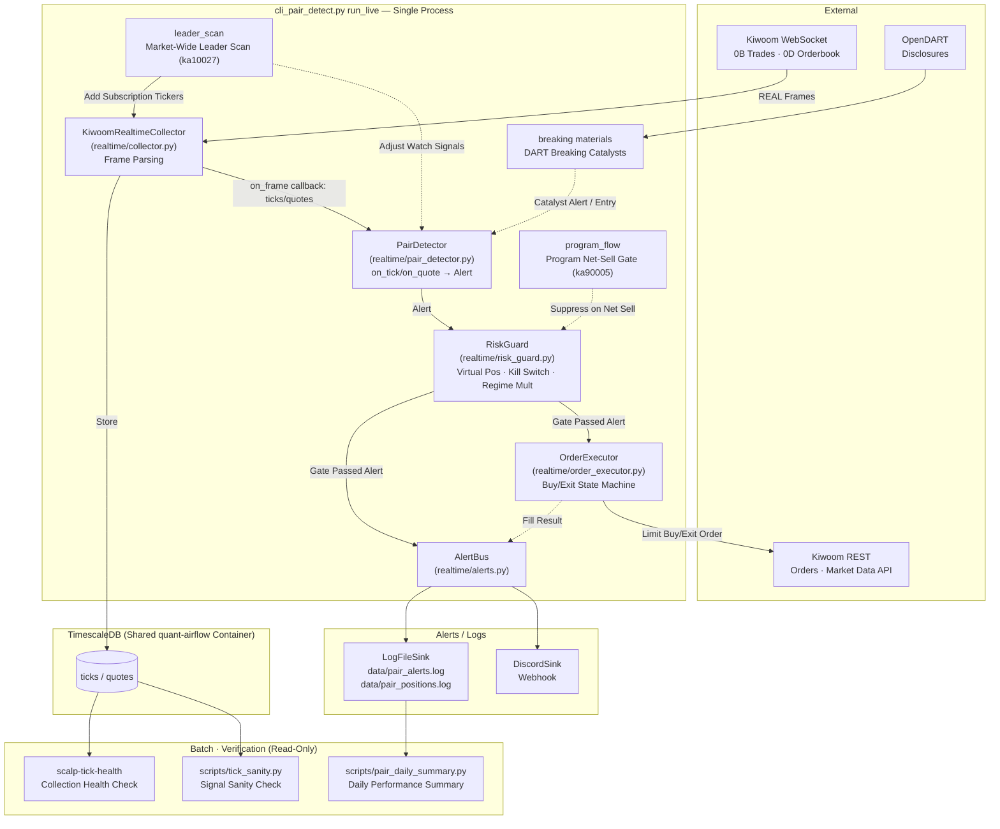

<picture>
  <source media="(prefers-color-scheme: dark)" srcset="docs/images/brand/banner-dark.svg">
  
</picture>

[한국어](README.md) | **English**

**A validation framework and real-time collection/detection runner for Korean equity (KOSPI · KOSDAQ) intraday scalping strategies.** Core loop: intraday tick/orderbook streaming → leader–follower pair signal detection → post-hoc empirical measurement.

[](https://www.python.org/)
[](LICENSE)

- **Single-session collection + real-time detection**: Streams Kiwoom WebSocket (`0B` trades · `0D` orderbook) frames into TimescaleDB while simultaneously feeding `PairDetector` to evaluate leader–follower pair signals with near-zero latency.
- **Strict guardrails & dry-run default**: Execution only proceeds after passing `RiskGuard` (daily loss limit, consecutive stop-loss limit, kill switch) and the shared `krx-quant-core` order guard; without `--confirm-real`, zero orders are placed (dry-run).
- **Pre-registration & single-test discipline**: Rejected hypotheses are never rescued by post-hoc parameter tuning; all verdicts and decisions are logged chronologically in [`docs/TRADING_CRITERIA.md`](docs/TRADING_CRITERIA.md).

> ⚠️ **The repo name is a historical artifact.** It no longer targets swing trading, but rather
> **replicates a public individual trader's intraday scalping system**.
> **Live order placement has been halted since the night of 2026-09-16 — currently running in dry-run mode** (0 orders).
> Only between 2026-08-27 and 2026-09-16 were 1-share live orders placed via `--confirm-real` (see `scripts/pair_detect_daily.sh` header).
> The October 2026 pre-registered research program (orderbook-flow scalping, LightGBM, Double-DQN, queue-aware limit-order engine) was
> **officially concluded with all forward tests rejected** (failing to clear retail round-trip costs). Currently, only intraday tick/minute-bar collection and health checks are active.
> Current verdicts and decisions are recorded in [`docs/TRADING_CRITERIA.md`](docs/TRADING_CRITERIA.md) (reverse-chronological log).

There is one core rule — **pre-register, measure once, and record the outcome as-is.**
Parameters are never tweaked to resurrect a rejected idea.

## Prerequisites

- **Kiwoom Securities account + REST/WebSocket API keys** (App key/secret) — accessed via sibling repo [kiwoom-client](https://github.com/younghwan91/kiwoom-client).
- **Sibling repo clone**: `quant-airflow` must exist in the same parent directory as this repo. DB credentials (`KR_QUANT_DB`) and Kiwoom App key/secret are read from its `.env`.
- **TimescaleDB**: Shares the `kr_quant` DB operated by `quant-airflow` (`KR_QUANT_DB`). See [DB Dependency](#db-dependency-caution) below for caveats.
- **All configuration via environment variables** (there is no `.env.example`). `KR_QUANT_DB`, `KIWOOM_APP_KEY`, `KIWOOM_APP_SECRET`, and `DART_API_KEY` are loaded from `quant-airflow`'s `.env` and never stored in this repo. The live-order path (`--confirm-real`) additionally requires `SCALP_HELD_STOCK_CODES` (comma-separated ticker codes already held in the account, blocked from ordering), otherwise the order client rejects startup (fail-closed).

## Installation & Usage

```bash
uv sync --extra dev
uv run pytest

export $(grep -v '^#' ../quant-airflow/.env | xargs)                   # KR_QUANT_DB + KIWOOM_APP_*
```

**Intraday real-time** — The two commands below hit the live API and write to the live DB. Since cron already runs them, only run manually when avoiding duplicate sessions (App key conflict).

```bash
uv run --extra pg scalp-pair-detect --live --live-order --duration 09:00-15:20   # Pair detector
                                    # Dry-run (0 orders) unless --confirm-real is passed. Also collects socket frames
uv run scalp-tick-collect --auto 45 --duration 08:50-15:40   # Tick & orderbook collector daemon (0B/0D)
uv run scalp-tick-health --minutes 20                        # Collection health check (read-only)
```

**Batch & backtesting**

```bash
uv run scalp-theme-snapshot --sleep 0.3     # Today's Kiwoom theme membership snapshot (daily)
uv run scalp-intraday --codes 005930 --pages 5               # Minute-bar collection
uv run --extra pg python scripts/tick_sanity.py --date today # Tick sanity check
python3 scripts/pair_daily_summary.py       # Daily pair dry-run performance summary
```

## Architecture (Primary Live Path: `scalp-pair-detect --live`)



**Flow Summary**

1. **Collect** — `KiwoomRealtimeCollector` receives Kiwoom WebSocket 0B/0D frames, parses them, and writes `ticks`/`quotes` to TimescaleDB (dual-purpose collection & detection due to the 1-session-per-App-key constraint).
2. **Detect** — The same frames flow immediately into `PairDetector.on_tick`/`on_quote` to evaluate leader–follower pair signals (~0 latency, no DB polling). `leader_scan` (market-wide leader search) and `breaking materials` (DART breaking catalysts) augment watched tickers and signals.
3. **Gate** — Every detected `Alert` must pass `RiskGuard`—enforcing daily loss limits, consecutive stop-loss limits, manual kill switch, regime sizing, and leader-exit conditional liquidation. `program_flow` (program net selling) can additionally suppress entries.
4. **Execute / Alert** — Once gated, `OrderExecutor` places 1-share limit buy/exit orders via Kiwoom REST (dry-run by default), while `AlertBus` notifies humans via log files and Discord webhooks (orders are automated with no human intervention; alerts are for human monitoring).
5. **Verify (Batch, Read-Only)** — `scalp-tick-health` monitors collection health, `tick_sanity.py` checks signal hypotheses, and `pair_daily_summary.py` aggregates daily dry-run performance post-hoc.

## Operations (cron, Weekdays)

Everything runs on a **single host (`simnode`)** — the canonical crontab is [`deploy/crontab.simnode`](deploy/crontab.simnode) (installed via `cron-install` in dotfiles; do not edit manually). Key entries:

| Time | Task |
|---|---|
| 08:45 | `scripts/preopen_check.sh` — Pre-open check (read-only) |
| 08:55 | `scripts/pair_detect_daily.sh` — Start pair detector dry-run. Also collects ticks/orderbooks, auto-restarts on crash, self-terminates at 15:20 |
| 09:10 · 10:00 | `scalp-tick-health --minutes 20` — Collection health check |
| 15:25 | `scripts/pair_daily_summary.py` — Daily pair performance summary |
| 15:40 | Terminate collection/detection processes (`pkill`) |
| 15:45 | `scalp-morning --date today` — Today's aggregation for morning report · Minute-bar collection (`scalp_it.cli_intraday`) |
| 16:00 | `scripts/tick_sanity.py --date today` |
| 16:05 | `scripts/news_judge_shadow.py` — News judgment reactive trading shadow |
| 16:10 | `scalp-theme-snapshot` — Daily Kiwoom theme snapshot · `scripts/collect_health.py` |
| 18:30 | `scalp-coverage` — Filter-exclusion coverage measurement |

`scripts/db_guard.sh` (intraday DB container health guard) is excluded from cron.

**One Kiwoom App key = one WebSocket session.** Therefore `scalp-tick-collect` is not launched separately; the pair detector handles collection (45 tickers). Launching both simultaneously kicks one another and drops ticks.

## DB Dependency (Caution)

Collectors and detectors run on a single host and write directly to `quant-airflow`'s TimescaleDB PRIMARY (`KR_QUANT_DB`).

**Ticks and orderbooks cannot be backfilled retroactively**, so if the DB dies completely during market hours, that day's data is permanently lost.

## Shared Core Dependency (`krx-quant-core`)

Market-specific rules and order guards are **not duplicated in this repo**—they are imported from [krx-quant-core](https://github.com/younghwan91/krx-quant-core) (v0.7.0, pinned in `pyproject.toml`). Sharing the exact same functions as `daytrade-it` and `swing-it` keeps backtests, live execution, and sibling repos consistent.

| `scalp-it` symbol (importable as-is) | Core canonical source |
|---|---|
| `ticksize.tick_size` / `ticks_in` | `market.ticks.tick_size_int` / `ticks_in_float` (table itself in `kiwoom-client`) |
| `realtime.pair_detector.limit_up_price` · `scripts/limitup_timing.py` | `market.limits.limit_up_price` |
| `pair_detector.roundtrip_bp` / `liquidity_size_multiplier` | `backtest.orderbook` |
| `realtime.leader_scan.past_cutoff` / `in_adoption_window` | `market.session.past_cutoff` / `in_window` |
| `news.calendar.align_to_trading_days` | `market.calendar.align_to_trading_days` |
| `adapters.kiwoom_order`'s `OrderIntent` · `OrderResult` · `OrderGuardConfig` · `OrderBlocked` · `normalize_code` · protocol constants, guard checks | `execution` (`OrderGuard` · `kiwoom_spec`) · `market.codes` |
| `adapters.kiwoom.strip_sign` | `execution.strip_sign` (errors wrapped in `KiwoomError` here) |
| Touch/through fill checks in `order_executor` · `risk_guard` | `backtest.fills` |
| `validate.compare.paired_bootstrap` | `stats.paired_date_bootstrap` |
| `cli_closebet` simnode guard | `runtime.require_host` |

**Account-specific state (held-stock blocklist via env var `SCALP_HELD_STOCK_CODES`, rejected by the order client if empty) and HTTP order transport (`KiwoomOrderClient`) remain here**—`OrderGuardConfig`/`OrderIntent` subclass core classes to populate held-stock blocks and ticker names.
When bumping the core version, update the tag, run `uv lock`, and run the full test suite (including `tests/test_kiwoom_order.py`).
Cost constants (`COST_*`) are fixed assumptions per script, and date-specific transaction tax schedules live in `krx_quant_core.costs`.

## Documentation

| | |
|---|---|
| [`docs/TRADING_CRITERIA.md`](docs/TRADING_CRITERIA.md) | **Start here** — Chronological decisions and current verdict status |
| [`docs/PROMOTION_CHECKLIST.md`](docs/PROMOTION_CHECKLIST.md) | Gates required before resuming live orders |
| [`docs/PAIR_TRADING_RUNBOOK.md`](docs/PAIR_TRADING_RUNBOOK.md) | Pair live-trading runbook — dry-run → live order procedure, safeguards |
| `docs/research/manju/` | Original system research, pre-registration, and verdicts |
| `docs/archive/` | v1/v2 historical records + **5 failures to never forget** |

## Related Repos

| Repo | Role |
|---|---|
| [kiwoom-client](https://github.com/younghwan91/kiwoom-client) | Quotes, flow, minute bars, themes, orders (182 REST + WebSocket) |
| [krx-quant-core](https://github.com/younghwan91/krx-quant-core) | Korean equity core — tick size, price limits, sessions, order guards, fill logic, validation stats (see "Shared Core Dependency" above) |
| [swing-it](https://github.com/younghwan91/swing-it) | Validation framework (walk-forward · negative controls) + migrated low-frequency factors (PEAD · low volatility) |
| [quant-airflow](https://github.com/younghwan91/quant-airflow) | Daily data ingestion + TimescaleDB PRIMARY/replica setup (**shared DB** — see "DB Dependency" above) |

## Principles

- **Pre-register and measure once.** Never tweak parameters to rescue a rejected idea.
- **Don't look at the mean alone.** Inspect median, win rate, payoff ratio, quantiles, and year-by-year breakdowns together.
- **Deduct costs first.** 34 bp round-trip in 2026. Costs dominate intraday trading.
- **Never commit data.**

## License

[MIT](LICENSE)
