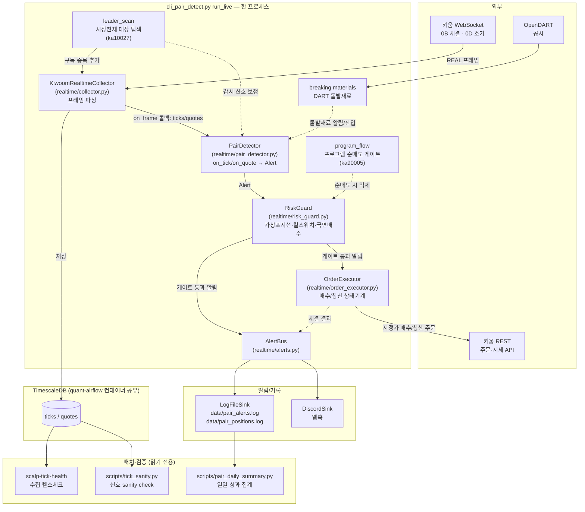

# scalp-it

한국 주식(KOSPI·KOSDAQ) 단타 전략의 **검증 프레임워크이자 실행 도구**.
장중 틱·호가 실시간 수집 → 신호 탐지 → 실측이 지금의 축이다.

> ⚠️ **레포 이름은 역사의 잔재다.** 지금은 스윙이 아니라
> **트레이더 만쥬의 일중 단타 시스템 복제**를 만든다.
> **2026-09-16 밤부터 실주문 중단 — 지금은 dry-run**(주문 0). 2026-08-27~09-16 에만
> `--confirm-real` 로 1주 실주문이 나갔다(`scripts/pair_detect_daily.sh` 헤더 참고).
> 2026년 10월 사전등록 연구 프로그램(호가 흐름 스캘핑, LightGBM, Double-DQN, 대기열 인지 지정가 엔진)은
> **전진 판정 전부 기각으로 공식 종결**(소매 왕복비용 미달성). 현재는 장중 틱·분봉 실시간 수집 및 헬스체크만 운영.
> 현재 상태·판정 현황은 [`docs/STATUS.md`](docs/STATUS.md) 부터.

핵심 규율은 하나다 — **사전등록하고, 한 번만 재고, 결과를 그대로 기록한다.**
기각된 것을 살리려고 파라미터를 바꾸지 않는다.

## 시작 전에 (전제조건)

- **키움증권 계좌 + REST/WebSocket API 키**(App key/secret) — 형제 레포
  [kiwoom-client](https://github.com/younghwan91/kiwoom-client) 로 접근한다.
- **형제 레포 클론**: 이 레포와 같은 부모 디렉터리에 `quant-airflow` 가 있어야 한다.
  DB 접속정보(`KR_QUANT_DB`)와 키움 App key/secret 을 그 `.env` 에서 읽어온다.
- **TimescaleDB 컨테이너**: `quant-airflow` 가 띄우는
  `quant-airflow-timescaledb-replica-1` 컨테이너를 공유해서 쓴다(:5433/kr_quant).
  자세한 주의사항은 아래 [DB 의존성](#db-의존성-주의) 참고.

## 설치 · 실행

```bash
uv sync --extra dev
uv run pytest

export $(grep -v '^#' ../quant-airflow/.env | xargs)                   # KR_QUANT_DB + KIWOOM_APP_*
```

**장중 실시간** — 아래 둘은 실 API 를 때리고 라이브 DB 에 쓴다. cron 이 이미 돌리므로
수동 실행은 중복 세션(App key 충돌)을 피할 때만.

```bash
uv run --extra pg scalp-pair-detect --live --live-order --duration 09:00-15:20   # 짝꿍 감지기
                                    # --confirm-real 없으면 dry-run(주문 0). 소켓 수집 겸함
uv run scalp-tick-collect --auto 45 --duration 08:50-15:40   # 틱·호가 수집 데몬 (0B/0D)
uv run scalp-tick-health --minutes 20                        # 수집 헬스체크 (읽기 전용)
```

**배치·백테스트**

```bash
uv run scalp-theme-snapshot --sleep 0.3     # 키움 테마 소속 오늘 스냅샷 (매일)
uv run scalp-intraday --codes 005930 --pages 5               # 분봉 수집
uv run --extra pg python scripts/tick_sanity.py --date today # 틱 sanity
python3 scripts/pair_daily_summary.py       # 짝꿍 dry-run 일일 성과 집계
```

## 아키텍처 (실전 주경로: `scalp-pair-detect --live`)



**흐름 요약**

1. **수집** — `KiwoomRealtimeCollector` 가 키움 WebSocket 0B/0D 프레임을 받아 파싱하고
   `ticks`/`quotes` 로 TimescaleDB 에 저장한다(수집·감지 겸용, App key 1세션 제약).
2. **감지** — 같은 프레임을 `PairDetector.on_tick`/`on_quote` 에 즉시 흘려 대장-후속
   짝꿍 신호를 판정한다(DB 폴링 없이 지연 ~0). `leader_scan`(시장 전체 대장 탐색)과
   `breaking materials`(DART 돌발재료)가 감시 종목·신호를 보강한다.
3. **게이트** — 감지된 `Alert` 는 `RiskGuard` 를 반드시 거친다 — 일일 손실한도·연속
   손절·수동정지 킬스위치, 국면별 비중, 대장이탈 조건부 청산을 여기서 판정하고,
   `program_flow`(프로그램 순매도)가 진입을 추가로 억제할 수 있다.
4. **실행/알림** — 게이트를 통과하면 `OrderExecutor` 가 키움 REST 로 1주 지정가
   매수·청산 주문을 내고(기본 dry-run), `AlertBus` 가 로그 파일과 Discord 웹훅으로
   사람에게 알린다(주문은 자동, 사람 개입 없음이 원칙이나 알림 채널은 사람용).
5. **검증(배치, 읽기 전용)** — `scalp-tick-health` 가 수집 헬스를, `tick_sanity.py` 가
   신호 가설을, `pair_daily_summary.py` 가 dry-run 일일 성과를 각각 사후 집계한다.

## 운영 (cron, 평일)

**2026-10-07 trader(N100) 처분 이후 simnode 단일 호스트**에서 전부 돈다 — 크론 정본은
[`deploy/crontab.simnode`](deploy/crontab.simnode)(dotfiles 의 cron-install 이 설치, 손으로 고치지 말 것).
아래는 주요 줄만 추린 것이다.

| 시각 | 하는 일 |
|---|---|
| 08:45 | `scripts/preopen_check.sh` — 개장 전 점검(읽기 전용) |
| 08:55 | `scripts/pair_detect_daily.sh` — 짝꿍 감지기 dry-run 시작. 틱·호가 수집 겸함, 크래시 자동 재시작, 15:20 자체 종료 |
| 09:10 · 10:00 | `scalp-tick-health --minutes 20` — 수집 헬스체크 |
| 15:25 | `scripts/pair_daily_summary.py` — 짝꿍 일일 성과 집계 |
| 15:40 | 수집·감지 프로세스 종료(`pkill`) |
| 15:45 | `scalp-morning --date today` — 아침 리포트용 당일치 집계 · 분봉 수집(`scalp_it.cli_intraday`) |
| 16:00 | `scripts/tick_sanity.py --date today` |
| 16:05 | `scripts/news_judge_shadow.py` — 뉴스 판단 반응매매 그림자 |
| 16:10 | `scalp-theme-snapshot` — 키움 테마 일일 스냅샷 · `scripts/collect_health.py` |
| 18:30 | `scalp-coverage` — 필터배제 커버리지 측정 |

`scripts/db_guard.sh`(장중 DB 컨테이너 헬스가드)는 크론에서 제외되어 있다.

**키움 App key 1개 = WebSocket 세션 1개.** 그래서 `scalp-tick-collect` 를 따로 띄우지 않고
짝꿍 감지기가 수집을 겸한다(45종목). 두 프로세스를 동시에 띄우면 서로 kick 해 틱이 유실된다.

## DB 의존성 (주의)

2026-10-07 trader(N100) 처분 이후 **simnode 단일 호스트**에서 수집기·감지기가 돌며, 같은 호스트의 TimescaleDB PRIMARY(`192.168.45.9:5433` / `quant-airflow-timescaledb-1`)에 직접 쓴다.

**틱·호가는 소급 수집이 불가능**하므로, DB 가 장중에 완전히 죽으면 그날 데이터는 영구 손실이다.

## 공통 코어 의존성 (krx-quant-core)

시장 규칙·주문 가드처럼 **시장에만 묶인 로직은 이 레포에 사본을 두지 않고**
[krx-quant-core](https://github.com/younghwan91/krx-quant-core) (v0.7.0, `pyproject.toml` 에 핀)에서
가져온다. daytrade-it·swing-it 과 같은 함수를 봐야 백테스트·실시간·다른 레포의 판정이 어긋나지 않는다.

| scalp-it 이름 (그대로 import 가능) | 코어 정본 |
|---|---|
| `ticksize.tick_size` / `ticks_in` | `market.ticks.tick_size_int` / `ticks_in_float` (표 자체는 kiwoom-client) |
| `realtime.pair_detector.limit_up_price` · `scripts/limitup_timing.py` | `market.limits.limit_up_price` |
| `pair_detector.roundtrip_bp` / `liquidity_size_multiplier` | `backtest.orderbook` |
| `realtime.leader_scan.past_cutoff` / `in_adoption_window` | `market.session.past_cutoff` / `in_window` |
| `news.calendar.align_to_trading_days` | `market.calendar.align_to_trading_days` |
| `adapters.kiwoom_order` 의 `OrderIntent`·`OrderResult`·`OrderGuardConfig`·`OrderBlocked`·`normalize_code`·프로토콜 상수, 가드 판정 | `execution` (`OrderGuard`·`kiwoom_spec`) · `market.codes` |
| `adapters.kiwoom.strip_sign` | `execution.strip_sign` (오류는 여기서 `KiwoomError` 로 감쌈) |
| order_executor·risk_guard 의 touch/through 체결 판정 | `backtest.fills` |
| `validate.compare.paired_bootstrap` | `stats.paired_date_bootstrap` |
| `cli_closebet` simnode 가드 | `runtime.require_host` |

**계좌에 묶인 것(보유 3종목 `HELD_STOCK_CODES`)과 주문 HTTP 전송(`KiwoomOrderClient`)은 여기 남는다** —
`OrderGuardConfig`/`OrderIntent` 는 코어 클래스를 서브클래스해 보유 종목 차단·종목명을 채운다.
코어를 올릴 때는 태그를 바꾸고 `uv lock` 후 전체 테스트(`tests/test_kiwoom_order.py` 포함)를 돌린다.
비용 상수(`COST_*`)는 각 스크립트의 고정 가정값이고, 일자별 거래세 스케줄은 `krx_quant_core.costs` 에 있다.

## 문서

| | |
|---|---|
| [`docs/STATUS.md`](docs/STATUS.md) | **여기부터** — 현재 상태·판정 현황·다음 할 일 |
| [`docs/PAIR_TRADING_RUNBOOK.md`](docs/PAIR_TRADING_RUNBOOK.md) | 짝꿍 실시간 매매 런북 — dry-run→실발주 순서, 안전장치 |
| `docs/research/manju/` | 만쥬·스승 리서치, 사전등록, 판정 결과 |
|  `docs/archive/` | v1·v2 시기 기록 + **반드시 기억할 실패 5가지** |

## 관련 레포

| 레포 | 역할 |
|---|---|
| [kiwoom-client](https://github.com/younghwan91/kiwoom-client) | 시세·수급·분봉·테마·주문 (182 REST + WebSocket) |
| [krx-quant-core](https://github.com/younghwan91/krx-quant-core) | 국장 공통 코어 — 호가단위·상한가·세션·주문 가드·체결 판정·검증 통계 (위 "공통 코어 의존성") |
| [swing-it](https://github.com/younghwan91/swing-it) | 검증 프레임워크 (walk-forward·음성대조) + 이관된 저빈도 팩터(PEAD·저변동성) |
| [quant-airflow](https://github.com/younghwan91/quant-airflow) | 일일 데이터 적재 + TimescaleDB PRIMARY/리플리카 구성 (**DB 공유** — 위 "DB 의존성" 참고) |

## 원칙

- **사전등록하고 한 번만 잰다.** 기각된 것을 살리려 파라미터를 바꾸지 않는다
- **평균만 보지 않는다.** 중앙값·승률·손익비·분위·연도별을 함께 본다
- **비용을 먼저 뺀다.** 2026년 왕복 34bp. 단타는 비용이 지배한다
- **데이터는 커밋하지 않는다**


