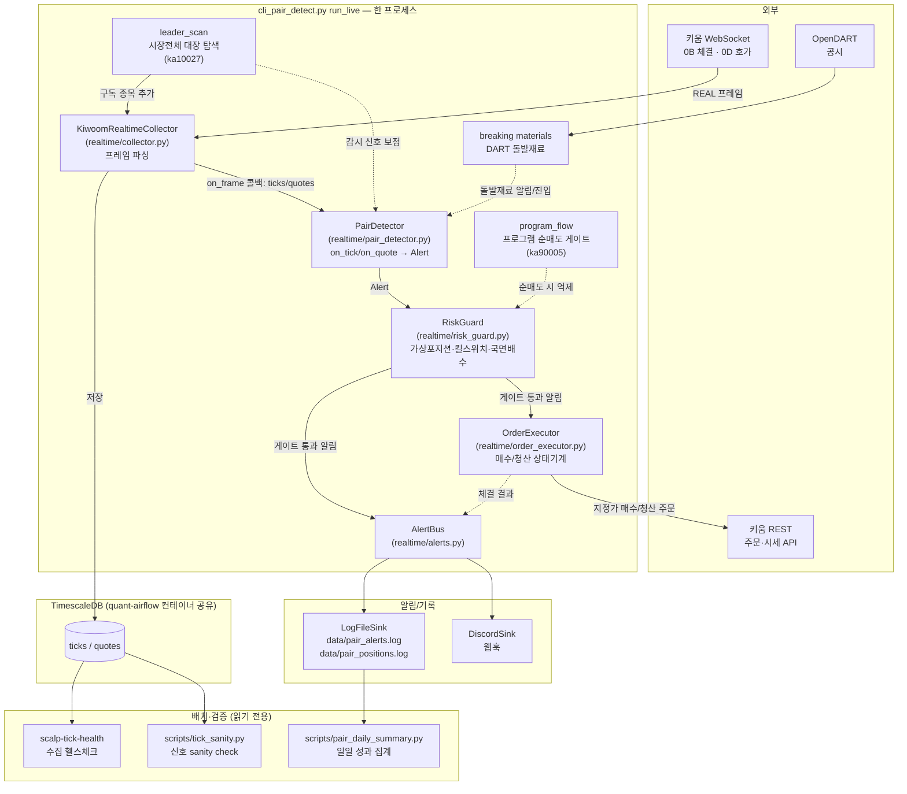

# scalp-it

> ⚠️ **레포 이름은 역사의 잔재다.** 지금은 스윙이 아니라
> **트레이더 만쥬의 일중 단타 시스템 복제**를 만든다.
> **먼저 읽을 것 → [`docs/STATUS.md`](docs/STATUS.md)**

한국 주식(KOSPI·KOSDAQ) 단타 전략의 **검증 프레임워크이자 실행 도구**.
장중 틱·호가 실시간 수집 → 신호 탐지 → 실측이 지금의 축이다.
**2026-08-28 부터 실주문 1주가 나간다**(그전까지 dry-run).

핵심 규율은 하나다 — **사전등록하고, 한 번만 재고, 결과를 그대로 기록한다.**
기각된 것을 살리려고 파라미터를 바꾸지 않는다.

## 현재 상태 (2026-08-29)

**만쥬 짝꿍매매를 실주문 1주로 돌리고 있다.** 2026-08-28 첫날 매매 0건 — 방아쇠가
안 터졌다. 규칙 배선은 만쥬 답변 기준으로 거의 끝났고, **남은 차이는 만쥬 본인이
"기계화 불가"라 한 둘**(뉴스 진위 판별, 호가창 악성 매도 직관)뿐이다.
전수 대조 → [`docs/research/manju/45-manju-parity.md`](docs/research/manju/45-manju-parity.md)

    진입   대장이 상한가 3호가 남긴 분 → 같은 테마 2·3등주를 현재가 위 2호가 지정가
    청산   대장이탈(손익 무관) > 추세청산(+3% 무장) > 손절 −0.5%(대장 굳히면 잠금)
           > 재난선 −2% > 타임스탑 180초
    필터   거래대금 게이트 · 프로그램 순매도 · 추격 금지 · 호가 두께 · 연속손절 3회 킬

**아직 돈이 되는지는 모른다.** 2026-08-24~28 분봉으로 재현해 보면 만쥬 규칙 그대로가
59건 세전 −0.332%(주간 −397만원)이고, 대장이 굳힌 건만 골라도 −0.112%다. 그 주
최고의 규칙은 **만쥬의 시황 게이트**였다 — 원문(코스닥 7~8조 미만이면 쉼)대로면 5일
전부 휴장이고 손익 0원이다. 자세히 → [`docs/STATUS.md`](docs/STATUS.md)

## 시험 판정: 29개 중 채택 3개

채택 3개(**PEAD** · **저변동성** · **단기반전**)는 전부 저빈도 팩터라
**`kr-quant` 로 이관**했다. 이 레포에 남은 단타·틱 영역의 채택은 아직 **0개**다.

> ⚠️ **종가베팅 채택은 2026-08-22 철회됐다.** 선택의 **60.4% 가 당일 상한가 마감**이고
> 수익이 전부 거기서 나오는데, 상한가는 종가 동시호가에 매수 체결이 거의 불가능하다
> (분봉 확인: 당일 거래대금의 0.04%). 상한가를 빼면 net **−0.20%**, 11년 중 8년 음수.
> 자세히 → `docs/research/manju/06-closebet-preregistration.md` 맨 아래

기각: 종가베팅(v1·v2) · 상따(일봉·분봉) · 시가베팅 · 돌파 · 낙주 · 공매도 팩터 ·
DART 재료 필터 · 장중 궤적→익일 갭 · 청산 4기법(MFE·트레일링·3:3:4) ·
기계 시장가 틱 스캘핑(세금이 순엣지를 먹는다)

## 아키텍처 (실전 주경로: `scalp-pair-detect --live`)



**흐름 요약**

1. **수집** — `KiwoomRealtimeCollector` 가 키움 WebSocket 0B/0D 프레임을 받아 파싱하고
   `ticks`/`quotes` 로 TimescaleDB 에 저장한다(수집·감지 겸용, App key 1세션 제약).
2. **감지** — 같은 프레임을 `PairDetector.on_tick`/`on_quote` 에 즉시 흘려 대장-후속
   짝꿍 신호를 판정한다(DB 폴링 없이 지연 ~0). `leader_scan`(시장 전체 대장 탐색)과
   `breaking materials`(DART 돌발재료)가 감시 종목·신호를 보강한다.
3. **게이트** — 감지된 `Alert` 는 `RiskGuard` 를 반드시 거친다 — 일일 손실한도·연속
   손절·수동정지 킬스위치, 국면별 비중, 대장이탈 조건부 청산을 여기서 판정하고,
   `program_flow`(프로그램 순매도)가 진입을 추가로 억제할 수 있다.
4. **실행/알림** — 게이트를 통과하면 `OrderExecutor` 가 키움 REST 로 1주 지정가
   매수·청산 주문을 내고(기본 dry-run), `AlertBus` 가 로그 파일과 Discord 웹훅으로
   사람에게 알린다(주문은 자동, 사람 개입 없음이 원칙이나 알림 채널은 사람용).
5. **검증(배치, 읽기 전용)** — `scalp-tick-health` 가 수집 헬스를, `tick_sanity.py` 가
   신호 가설을, `pair_daily_summary.py` 가 dry-run 일일 성과를 각각 사후 집계한다.

## 실행

```bash
uv sync --extra dev
uv run pytest                       # 915 tests

export $(grep -v '^#' ../kr-quant/.env | xargs)                        # KR_QUANT_DB
export $(grep -E '^KIWOOM_APP_(KEY|SECRET)=' ../quant-airflow/.env | xargs)
```

**장중 실시간** — 아래 둘은 실 API 를 때리고 라이브 DB 에 쓴다. cron 이 이미 돌리므로
수동 실행은 중복 세션(App key 충돌)을 피할 때만.

```bash
uv run --extra pg scalp-pair-detect --live --live-order --duration 09:00-15:20   # 짝꿍 감지기
                                    # --confirm-real 없으면 dry-run(주문 0). 소켓 수집 겸함
uv run scalp-tick-collect --auto 45 --duration 08:50-15:40   # 틱·호가 수집 데몬 (0B/0D)
uv run scalp-tick-health --minutes 20                        # 수집 헬스체크 (읽기 전용)
```

**배치·백테스트**

```bash
uv run scalp-theme-snapshot --sleep 0.3     # 키움 테마 소속 오늘 스냅샷 (매일)
uv run scalp-intraday --codes 005930 --pages 5               # 분봉 수집
uv run --extra pg python scripts/tick_sanity.py --date today # 틱 sanity
python3 scripts/pair_daily_summary.py       # 짝꿍 dry-run 일일 성과 집계

uv run scalp-closebet --start 2016-09-09 --end 2026-08-14 \
  --rule tv_ratio:3.0: --rule close_pos:0.8: --exit open     # 종가베팅 (철회된 기법, 재현용)
uv run scalp-cbet-watch --score                              # 종가베팅 전진 기록 채점
```

## 운영 (cron, 평일)

| 시각 | 하는 일 |
|---|---|
| 08:00~15:55 (5분마다) | `scripts/db_guard.sh` — 장중 DB 컨테이너 헬스가드 |
| 08:55 | `scripts/pair_detect_daily.sh` — 짝꿍 감지기 dry-run 시작. 틱·호가 수집 겸함, 크래시 자동 재시작, 15:20 자체 종료 |
| 09:10 · 10:00 | `scalp-tick-health --minutes 20` — 수집 헬스체크 |
| 15:25 | `scripts/pair_daily_summary.py` — 짝꿍 일일 성과 집계 |
| 15:40 | 수집·감지 프로세스 종료(`pkill`) |
| 16:00 | `scripts/tick_sanity.py --date today` |
| 16:10 | `scalp-theme-snapshot` — 키움 테마 일일 스냅샷 |

**키움 App key 1개 = WebSocket 세션 1개.** 그래서 `scalp-tick-collect` 를 따로 띄우지 않고
짝꿍 감지기가 수집을 겸한다(45종목). 두 프로세스를 동시에 띄우면 서로 kick 해 틱이 유실된다.

## DB 의존성 (주의)

`KR_QUANT_DB` 는 형제 레포 quant-airflow 의 **`quant-airflow-timescaledb-1` 컨테이너를 공유**한다
(localhost:5432/kr_quant). 이 컨테이너가 장중에 내려가면 그날 틱 수집이 끊긴다 — 틱·호가는
**소급 수집이 불가능**하므로 그날 데이터는 영구 손실이다.

- **2026-08-25 이후 quant-airflow 는 이 DB 를 안 내린다.** `scripts/wait_and_stop.sh` 가
  종료 대상을 airflow 4종으로 좁히고 timescaledb 를 제외했다. 그전에는 그날 DAG 가 끝나면
  `docker compose stop` 으로 스택을 통째로 내려서 장중에 우리 DB 를 죽일 위험이 있었다.
- `scripts/db_guard.sh` 는 그대로 둔다 — 다른 경로(수동 `compose down`·호스트 재부팅 등)로
  DB 가 죽는 경우를 5분마다 막는 비침습 방어다. 정상이면 아무것도 하지 않는다.
- 컨테이너가 **아예 없으면**(compose down 으로 제거) db_guard 는 살릴 수 없다 —
  quant-airflow 쪽에서 `docker compose up -d` 해야 한다.

## 문서

| | |
|---|---|
| [`docs/STATUS.md`](docs/STATUS.md) | **여기부터** — 현재 상태·판정 현황·다음 할 일 |
| [`docs/PAIR_TRADING_RUNBOOK.md`](docs/PAIR_TRADING_RUNBOOK.md) | 짝꿍 실시간 매매 런북 — dry-run→실발주 순서, 안전장치 |
| `docs/research/manju/` | 만쥬·스승 리서치, 사전등록, 판정 결과 |
|  `docs/archive/` | v1·v2 시기 기록 + **반드시 기억할 실패 5가지** |

## 관련 레포

| 레포 | 역할 |
|---|---|
| [kiwoom-client](https://github.com/younghwan91/kiwoom-client) | 시세·수급·분봉·테마·주문 (182 REST + WebSocket) |
| [kr-quant](https://github.com/younghwan91/kr-quant) | 검증 프레임워크 (walk-forward·음성대조) + 이관된 저빈도 팩터(PEAD·저변동성) |
| quant-airflow | 일일 데이터 적재 → TimescaleDB (**컨테이너 공유** — 위 "DB 의존성" 참고) |

## 원칙

- **사전등록하고 한 번만 잰다.** 기각된 것을 살리려 파라미터를 바꾸지 않는다
- **평균만 보지 않는다.** 중앙값·승률·손익비·분위·연도별을 함께 본다
- **비용을 먼저 뺀다.** 2026년 왕복 34bp. 단타는 비용이 지배한다
- **데이터는 커밋하지 않는다**
