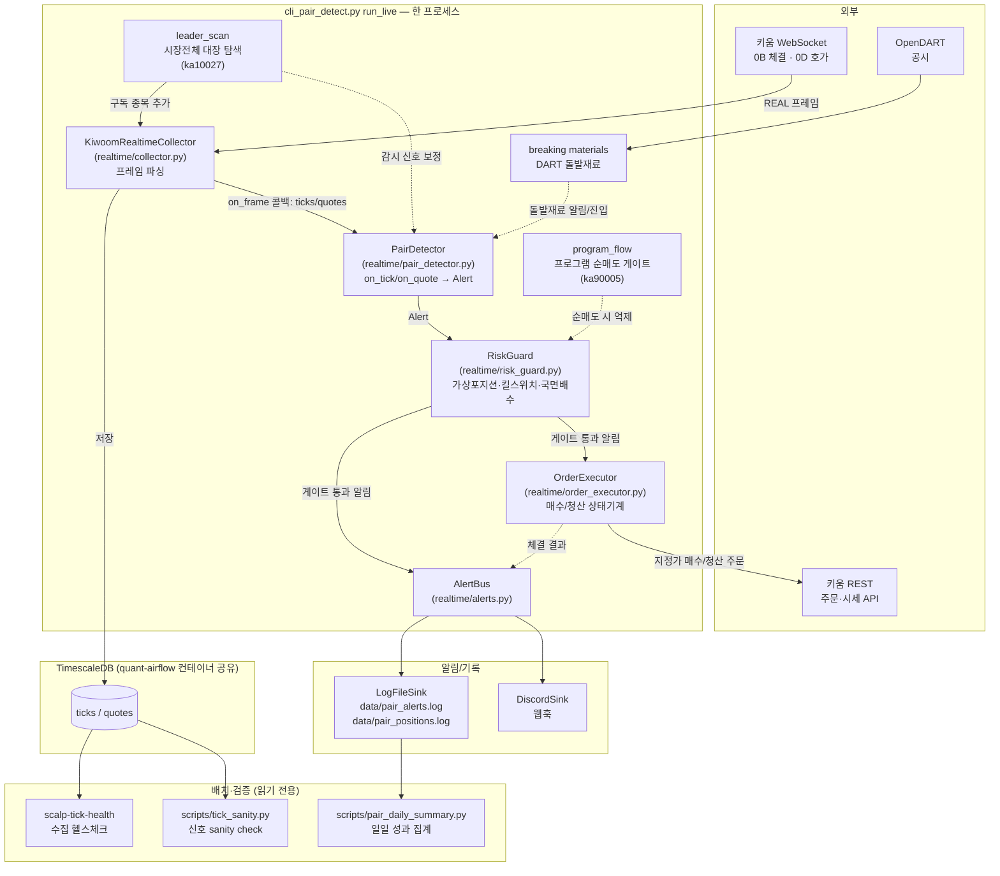

# scalp-it

한국 주식(KOSPI·KOSDAQ) 단타 전략의 **검증 프레임워크이자 실행 도구**.
장중 틱·호가 실시간 수집 → 신호 탐지 → 실측이 지금의 축이다.

> ⚠️ **레포 이름은 역사의 잔재다.** 지금은 스윙이 아니라
> **트레이더 만쥬의 일중 단타 시스템 복제**를 만든다.
> **2026-08-28 부터 실주문 1주가 나간다**(그전까지 dry-run).
> 현재 상태·판정 현황은 [`docs/STATUS.md`](docs/STATUS.md) 부터.

핵심 규율은 하나다 — **사전등록하고, 한 번만 재고, 결과를 그대로 기록한다.**
기각된 것을 살리려고 파라미터를 바꾸지 않는다.

## 시작 전에 (전제조건)

- **키움증권 계좌 + REST/WebSocket API 키**(App key/secret) — 형제 레포
  [kiwoom-client](https://github.com/younghwan91/kiwoom-client) 로 접근한다.
- **형제 레포 클론**: 이 레포와 같은 부모 디렉터리에 `quant-airflow` 가 있어야 한다.
  DB 접속정보(`KR_QUANT_DB`)와 키움 App key/secret 을 그 `.env` 에서 읽어온다.
  ([swing-it](https://github.com/younghwan91/swing-it), 구 kr-quant는 스윙 리서치
  전용이라 trader에는 더 이상 클론하지 않는다 — 2026-09-13.)
- **TimescaleDB 컨테이너**: `quant-airflow` 가 띄우는
  `quant-airflow-timescaledb-1` 컨테이너를 공유해서 쓴다(localhost:5432/kr_quant).
  자세한 주의사항은 아래 [DB 의존성](#db-의존성-주의) 참고.

## 설치 · 실행

```bash
uv sync --extra dev
uv run pytest                       # 1189 tests

export $(grep -v '^#' ../quant-airflow/.env | xargs)                   # KR_QUANT_DB + KIWOOM_APP_*
```

**장중 실시간** — 아래 둘은 실 API 를 때리고 라이브 DB 에 쓴다. cron 이 이미 돌리므로
수동 실행은 중복 세션(App key 충돌)을 피할 때만.

```bash
uv run --extra pg scalp-pair-detect --live --live-order --duration 09:00-15:20   # 짝꿍 감지기
                                    # --confirm-real 없으면 dry-run(주문 0). 소켓 수집 겸함
uv run scalp-tick-collect --auto 45 --duration 08:50-15:40   # 틱·호가 수집 데몬 (0B/0D)
uv run scalp-tick-health --minutes 20                        # 수집 헬스체크 (읽기 전용)
```

**배치·백테스트**

```bash
uv run scalp-theme-snapshot --sleep 0.3     # 키움 테마 소속 오늘 스냅샷 (매일)
uv run scalp-intraday --codes 005930 --pages 5               # 분봉 수집
uv run --extra pg python scripts/tick_sanity.py --date today # 틱 sanity
python3 scripts/pair_daily_summary.py       # 짝꿍 dry-run 일일 성과 집계
```

## 아키텍처 (실전 주경로: `scalp-pair-detect --live`)



**흐름 요약**

1. **수집** — `KiwoomRealtimeCollector` 가 키움 WebSocket 0B/0D 프레임을 받아 파싱하고
   `ticks`/`quotes` 로 TimescaleDB 에 저장한다(수집·감지 겸용, App key 1세션 제약).
2. **감지** — 같은 프레임을 `PairDetector.on_tick`/`on_quote` 에 즉시 흘려 대장-후속
   짝꿍 신호를 판정한다(DB 폴링 없이 지연 ~0). `leader_scan`(시장 전체 대장 탐색)과
   `breaking materials`(DART 돌발재료)가 감시 종목·신호를 보강한다.
3. **게이트** — 감지된 `Alert` 는 `RiskGuard` 를 반드시 거친다 — 일일 손실한도·연속
   손절·수동정지 킬스위치, 국면별 비중, 대장이탈 조건부 청산을 여기서 판정하고,
   `program_flow`(프로그램 순매도)가 진입을 추가로 억제할 수 있다.
4. **실행/알림** — 게이트를 통과하면 `OrderExecutor` 가 키움 REST 로 1주 지정가
   매수·청산 주문을 내고(기본 dry-run), `AlertBus` 가 로그 파일과 Discord 웹훅으로
   사람에게 알린다(주문은 자동, 사람 개입 없음이 원칙이나 알림 채널은 사람용).
5. **검증(배치, 읽기 전용)** — `scalp-tick-health` 가 수집 헬스를, `tick_sanity.py` 가
   신호 가설을, `pair_daily_summary.py` 가 dry-run 일일 성과를 각각 사후 집계한다.

## 운영 (cron, 평일)

이 레포는 **trader**(실시간 수집·매매)와 **simnode**(재현 가능한 배치·분석) 두 호스트에
나눠 돈다 — 같은 레포를 양쪽에 clone 해두고, 트리거 시각은 옛 trader 단일 호스트 시절 그대로다.

| 시각 | 호스트 | 하는 일 |
|---|---|---|
| 08:55 | trader | `scripts/pair_detect_daily.sh` — 짝꿍 감지기 dry-run 시작. 틱·호가 수집 겸함, 크래시 자동 재시작, 15:20 자체 종료 |
| 09:10 · 10:00 | trader | `scalp-tick-health --minutes 20` — 수집 헬스체크 |
| 15:25 | simnode | `scripts/pair_daily_summary.py` — 짝꿍 일일 성과 집계 |
| 15:40 | trader | 수집·감지 프로세스 종료(`pkill`) |
| 15:45 | trader | `scalp-morning --date today` — 아침 리포트용 당일치 집계 |
| 16:00 | trader | `scripts/tick_sanity.py --date today` |
| 16:05 | simnode | `scripts/news_judge_shadow.py` — 뉴스 판단 반응매매 그림자 |
| 16:10 | trader | `scalp-theme-snapshot` — 키움 테마 일일 스냅샷 |
| 18:30 | simnode | `scalp-coverage` — 필터배제 커버리지 측정 |

`scripts/db_guard.sh`(장중 DB 컨테이너 헬스가드)는 **2026-09-11 크론에서 뺐다** — 지금 걸어두면
아래 "DB 의존성"의 split-brain 위험을 만든다. 스크립트 파일 자체는 남아있으니(trader 가 다시
PRIMARY 를 맡게 되면 되살릴 근거), 재활성화 전에 파일 헤더 주석과 `pg_is_in_recovery()` 상태를
반드시 확인할 것.

**키움 App key 1개 = WebSocket 세션 1개.** 그래서 `scalp-tick-collect` 를 따로 띄우지 않고
짝꿍 감지기가 수집을 겸한다(45종목). 두 프로세스를 동시에 띄우면 서로 kick 해 틱이 유실된다.

## DB 의존성 (주의)

`KR_QUANT_DB`(`quant-airflow/.env`)는 **고정 호스트가 아니라 지금 PRIMARY 인 쪽**을 가리킨다 — 어느
쪽이 PRIMARY 인지는 `pg_is_in_recovery()` 로 확인한다(false = PRIMARY). 자세한 배경·전환 절차는
형제 레포 quant-airflow 의 README 상단 안내 상자 참고.

**2026-09-11 저녁부터**: PRIMARY 는 simnode(`192.168.45.9:5433`), trader 는 읽기 전용 스트리밍
리플리카(`quant-airflow-timescaledb-1`, localhost:5432)다. `KiwoomRealtimeCollector`(trader 에서
실행)는 LAN 너머 simnode PRIMARY 에 직접 쓴다 — 원래는 "PRIMARY 는 수집기와 같은 호스트에 있어야
LAN 순단에도 안 죽는다"는 제약 때문에 반대(trader=PRIMARY)였는데, collector 에 재연결+디스크
스풀(`spool_dir`)이 들어가 LAN 순단을 스스로 버티는 게 실전 검증되면서 그 제약이 풀렸다.

**틱·호가는 소급 수집이 불가능**하므로, PRIMARY 쪽 DB(지금은 simnode)가 장중에 완전히 죽으면
그날 데이터는 영구 손실이다 — trader 의 로컬 리플리카가 죽는 것과는 다르다(리플리카는 그냥
읽기 전용 사본이라 죽어도 수집엔 영향 없음, PRIMARY 에서 다시 시딩하면 됨).

## 문서

| | |
|---|---|
| [`docs/STATUS.md`](docs/STATUS.md) | **여기부터** — 현재 상태·판정 현황·다음 할 일 |
| [`docs/PAIR_TRADING_RUNBOOK.md`](docs/PAIR_TRADING_RUNBOOK.md) | 짝꿍 실시간 매매 런북 — dry-run→실발주 순서, 안전장치 |
| `docs/research/manju/` | 만쥬·스승 리서치, 사전등록, 판정 결과 |
|  `docs/archive/` | v1·v2 시기 기록 + **반드시 기억할 실패 5가지** |

## 관련 레포

| 레포 | 역할 |
|---|---|
| [kiwoom-client](https://github.com/younghwan91/kiwoom-client) | 시세·수급·분봉·테마·주문 (182 REST + WebSocket) |
| [swing-it](https://github.com/younghwan91/swing-it) (구 kr-quant) | 검증 프레임워크 (walk-forward·음성대조) + 이관된 저빈도 팩터(PEAD·저변동성) |
| quant-airflow | 일일 데이터 적재 + TimescaleDB PRIMARY/리플리카 구성 (**DB 공유** — 위 "DB 의존성" 참고) |

## 원칙

- **사전등록하고 한 번만 잰다.** 기각된 것을 살리려 파라미터를 바꾸지 않는다
- **평균만 보지 않는다.** 중앙값·승률·손익비·분위·연도별을 함께 본다
- **비용을 먼저 뺀다.** 2026년 왕복 34bp. 단타는 비용이 지배한다
- **데이터는 커밋하지 않는다**
