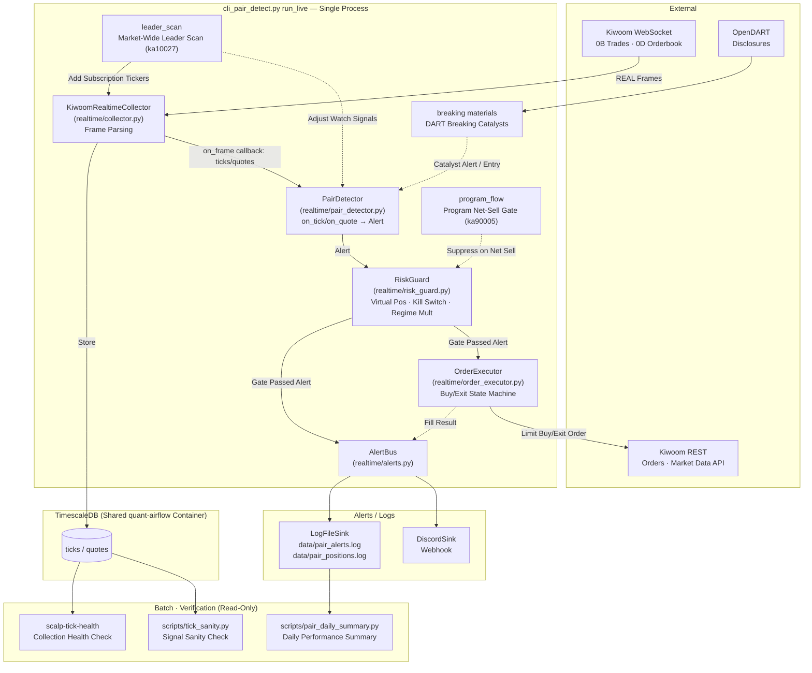

# scalp-it Guide

New here? Start with the [README](../README.en.md).

<!-- toc -->
- [Architecture (Primary Live Path: `scalp-pair-detect --live`)](#architecture-primary-live-path-scalp-pair-detect---live)
- [Operations (cron, Weekdays)](#operations-cron-weekdays)
- [DB Dependency (Caution)](#db-dependency-caution)
- [Shared Core Dependency (`krx-quant-core`)](#shared-core-dependency-krx-quant-core)
<!-- /toc -->

## Architecture (Primary Live Path: `scalp-pair-detect --live`)

**Flow Summary**

1. **Collect** — `KiwoomRealtimeCollector` receives Kiwoom WebSocket 0B/0D frames, parses them, and writes `ticks`/`quotes` to TimescaleDB (dual-purpose collection & detection due to the 1-session-per-App-key constraint).
2. **Detect** — The same frames flow immediately into `PairDetector.on_tick`/`on_quote` to evaluate leader–follower pair signals (~0 latency, no DB polling). `leader_scan` (market-wide leader search) and `breaking materials` (DART breaking catalysts) augment watched tickers and signals.
3. **Gate** — Every detected `Alert` must pass `RiskGuard`—enforcing daily loss limits, consecutive stop-loss limits, manual kill switch, regime sizing, and leader-exit conditional liquidation. `program_flow` (program net selling) can additionally suppress entries.
4. **Execute / Alert** — Once gated, `OrderExecutor` places 1-share limit buy/exit orders via Kiwoom REST (dry-run by default), while `AlertBus` notifies humans via log files and Discord webhooks (orders are automated with no human intervention; alerts are for human monitoring).
5. **Verify (Batch, Read-Only)** — `scalp-tick-health` monitors collection health, `tick_sanity.py` checks signal hypotheses, and `pair_daily_summary.py` aggregates daily dry-run performance post-hoc.

## Operations (cron, Weekdays)

Everything runs on a **single host (`simnode`)** — the canonical crontab is [`deploy/crontab.simnode`](../deploy/crontab.simnode) (installed via `cron-install` in dotfiles; do not edit manually). Key entries:

| Time | Task |
|---|---|
| 08:45 | `scripts/preopen_check.sh` — Pre-open check (read-only) |
| 08:55 | `scripts/pair_detect_daily.sh` — Start pair detector dry-run. Also collects ticks/orderbooks, auto-restarts on crash, self-terminates at 15:20 |
| 09:10 · 10:00 | `scalp-tick-health --minutes 20` — Collection health check |
| 15:25 | `scripts/pair_daily_summary.py` — Daily pair performance summary |
| 15:40 | Terminate collection/detection processes (`pkill`) |
| 15:45 | `scalp-morning --date today` — Today's aggregation for morning report · Minute-bar collection (`scalp_it.cli_intraday`) |
| 16:00 | `scripts/tick_sanity.py --date today` |
| 16:05 | `scripts/news_judge_shadow.py` — News judgment reactive trading shadow |
| 16:10 | `scalp-theme-snapshot` — Daily Kiwoom theme snapshot · `scripts/collect_health.py` |
| 18:30 | `scalp-coverage` — Filter-exclusion coverage measurement |

`scripts/db_guard.sh` (intraday DB container health guard) is excluded from cron.

**One Kiwoom App key = one WebSocket session.** Therefore `scalp-tick-collect` is not launched separately; the pair detector handles collection (45 tickers). Launching both simultaneously kicks one another and drops ticks.

## DB Dependency (Caution)

Collectors and detectors run on a single host and write directly to `quant-airflow`'s TimescaleDB PRIMARY (`KR_QUANT_DB`).

**Ticks and orderbooks cannot be backfilled retroactively**, so if the DB dies completely during market hours, that day's data is permanently lost.

## Shared Core Dependency (`krx-quant-core`)

Market-specific rules and order guards are **not duplicated in this repo**—they are imported from [krx-quant-core](https://github.com/younghwan91/krx-quant-core) (v0.7.0, pinned in `pyproject.toml`). Sharing the exact same functions as `daytrade-it` and `swing-it` keeps backtests, live execution, and sibling repos consistent.

| `scalp-it` symbol (importable as-is) | Core canonical source |
|---|---|
| `ticksize.tick_size` / `ticks_in` | `market.ticks.tick_size_int` / `ticks_in_float` (table itself in `kiwoom-client`) |
| `realtime.pair_detector.limit_up_price` · `scripts/limitup_timing.py` | `market.limits.limit_up_price` |
| `pair_detector.roundtrip_bp` / `liquidity_size_multiplier` | `backtest.orderbook` |
| `realtime.leader_scan.past_cutoff` / `in_adoption_window` | `market.session.past_cutoff` / `in_window` |
| `news.calendar.align_to_trading_days` | `market.calendar.align_to_trading_days` |
| `adapters.kiwoom_order`'s `OrderIntent` · `OrderResult` · `OrderGuardConfig` · `OrderBlocked` · `normalize_code` · protocol constants, guard checks | `execution` (`OrderGuard` · `kiwoom_spec`) · `market.codes` |
| `adapters.kiwoom.strip_sign` | `execution.strip_sign` (errors wrapped in `KiwoomError` here) |
| Touch/through fill checks in `order_executor` · `risk_guard` | `backtest.fills` |
| `validate.compare.paired_bootstrap` | `stats.paired_date_bootstrap` |
| `cli_closebet` simnode guard | `runtime.require_host` |

**Account-specific state (held-stock blocklist via env var `SCALP_HELD_STOCK_CODES`, rejected by the order client if empty) and HTTP order transport (`KiwoomOrderClient`) remain here**—`OrderGuardConfig`/`OrderIntent` subclass core classes to populate held-stock blocks and ticker names.
When bumping the core version, update the tag, run `uv lock`, and run the full test suite (including `tests/test_kiwoom_order.py`).
Cost constants (`COST_*`) are fixed assumptions per script, and date-specific transaction tax schedules live in `krx_quant_core.costs`.
