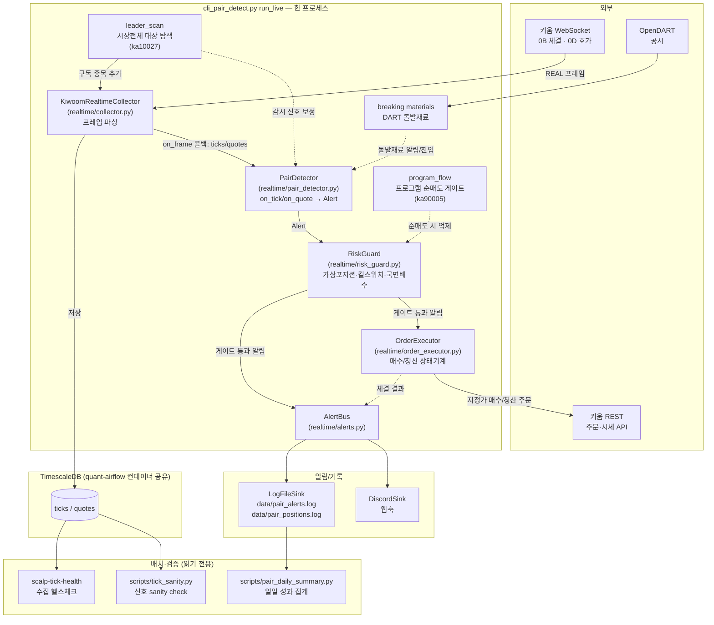

# scalp-it 가이드

처음이라면 [README](../README.md) 부터.

<!-- toc -->
- [아키텍처 (실전 주경로: `scalp-pair-detect --live`)](#아키텍처-실전-주경로-scalp-pair-detect---live)
- [운영 (cron, 평일)](#운영-cron-평일)
- [DB 의존성 (주의)](#db-의존성-주의)
- [공통 코어 의존성 (krx-quant-core)](#공통-코어-의존성-krx-quant-core)
<!-- /toc -->

## 아키텍처 (실전 주경로: `scalp-pair-detect --live`)

**흐름 요약**

1. **수집** — `KiwoomRealtimeCollector` 가 키움 WebSocket 0B/0D 프레임을 받아 파싱하고
   `ticks`/`quotes` 로 TimescaleDB 에 저장한다(수집·감지 겸용, App key 1세션 제약).
2. **감지** — 같은 프레임을 `PairDetector.on_tick`/`on_quote` 에 즉시 흘려 대장-후속
   짝꿍 신호를 판정한다(DB 폴링 없이 지연 ~0). `leader_scan`(시장 전체 대장 탐색)과
   `breaking materials`(DART 돌발재료)가 감시 종목·신호를 보강한다.
3. **게이트** — 감지된 `Alert` 는 `RiskGuard` 를 반드시 거친다 — 일일 손실한도·연속
   손절·수동정지 킬스위치, 국면별 비중, 대장이탈 조건부 청산을 여기서 판정하고,
   `program_flow`(프로그램 순매도)가 진입을 추가로 억제할 수 있다.
4. **실행/알림** — 게이트를 통과하면 `OrderExecutor` 가 키움 REST 로 1주 지정가
   매수·청산 주문을 내고(기본 dry-run), `AlertBus` 가 로그 파일과 Discord 웹훅으로
   사람에게 알린다(주문은 자동, 사람 개입 없음이 원칙이나 알림 채널은 사람용).
5. **검증(배치, 읽기 전용)** — `scalp-tick-health` 가 수집 헬스를, `tick_sanity.py` 가
   신호 가설을, `pair_daily_summary.py` 가 dry-run 일일 성과를 각각 사후 집계한다.

## 운영 (cron, 평일)

**단일 호스트(simnode)**에서 전부 돈다 — 크론 정본은
[`deploy/crontab.simnode`](../deploy/crontab.simnode)(dotfiles 의 cron-install 이 설치, 손으로 고치지 말 것).
아래는 주요 줄만 추린 것이다.

| 시각 | 하는 일 |
|---|---|
| 08:45 | `scripts/preopen_check.sh` — 개장 전 점검(읽기 전용) |
| 08:55 | `scripts/pair_detect_daily.sh` — 짝꿍 감지기 dry-run 시작. 틱·호가 수집 겸함, 크래시 자동 재시작, 15:20 자체 종료 |
| 09:10 · 10:00 | `scalp-tick-health --minutes 20` — 수집 헬스체크 |
| 15:25 | `scripts/pair_daily_summary.py` — 짝꿍 일일 성과 집계 |
| 15:40 | 수집·감지 프로세스 종료(`pkill`) |
| 15:45 | `scalp-morning --date today` — 아침 리포트용 당일치 집계 · 분봉 수집(`scalp_it.cli_intraday`) |
| 16:00 | `scripts/tick_sanity.py --date today` |
| 16:05 | `scripts/news_judge_shadow.py` — 뉴스 판단 반응매매 그림자 |
| 16:10 | `scalp-theme-snapshot` — 키움 테마 일일 스냅샷 · `scripts/collect_health.py` |
| 18:30 | `scalp-coverage` — 필터배제 커버리지 측정 |

`scripts/db_guard.sh`(장중 DB 컨테이너 헬스가드)는 크론에서 제외되어 있다.

**키움 App key 1개 = WebSocket 세션 1개.** 그래서 `scalp-tick-collect` 를 따로 띄우지 않고
짝꿍 감지기가 수집을 겸한다(45종목). 두 프로세스를 동시에 띄우면 서로 kick 해 틱이 유실된다.

## DB 의존성 (주의)

수집기·감지기는 단일 호스트에서 돌며 `quant-airflow` 의 TimescaleDB PRIMARY(`KR_QUANT_DB`)에 직접 쓴다.

**틱·호가는 소급 수집이 불가능**하므로, DB 가 장중에 완전히 죽으면 그날 데이터는 영구 손실이다.

## 공통 코어 의존성 (krx-quant-core)

시장 규칙·주문 가드처럼 **시장에만 묶인 로직은 이 레포에 사본을 두지 않고**
[krx-quant-core](https://github.com/younghwan91/krx-quant-core) (v0.7.0, `pyproject.toml` 에 핀)에서
가져온다. daytrade-it·swing-it 과 같은 함수를 봐야 백테스트·실시간·다른 레포의 판정이 어긋나지 않는다.

| scalp-it 이름 (그대로 import 가능) | 코어 정본 |
|---|---|
| `ticksize.tick_size` / `ticks_in` | `market.ticks.tick_size_int` / `ticks_in_float` (표 자체는 kiwoom-client) |
| `realtime.pair_detector.limit_up_price` · `scripts/limitup_timing.py` | `market.limits.limit_up_price` |
| `pair_detector.roundtrip_bp` / `liquidity_size_multiplier` | `backtest.orderbook` |
| `realtime.leader_scan.past_cutoff` / `in_adoption_window` | `market.session.past_cutoff` / `in_window` |
| `news.calendar.align_to_trading_days` | `market.calendar.align_to_trading_days` |
| `adapters.kiwoom_order` 의 `OrderIntent`·`OrderResult`·`OrderGuardConfig`·`OrderBlocked`·`normalize_code`·프로토콜 상수, 가드 판정 | `execution` (`OrderGuard`·`kiwoom_spec`) · `market.codes` |
| `adapters.kiwoom.strip_sign` | `execution.strip_sign` (오류는 여기서 `KiwoomError` 로 감쌈) |
| order_executor·risk_guard 의 touch/through 체결 판정 | `backtest.fills` |
| `validate.compare.paired_bootstrap` | `stats.paired_date_bootstrap` |
| `cli_closebet` simnode 가드 | `runtime.require_host` |

**계좌에 묶인 것(보유 종목 차단 목록 — 환경변수 `SCALP_HELD_STOCK_CODES`, 비면 주문 클라이언트가 거부)과 주문 HTTP 전송(`KiwoomOrderClient`)은 여기 남는다** —
`OrderGuardConfig`/`OrderIntent` 는 코어 클래스를 서브클래스해 보유 종목 차단·종목명을 채운다.
코어를 올릴 때는 태그를 바꾸고 `uv lock` 후 전체 테스트(`tests/test_kiwoom_order.py` 포함)를 돌린다.
비용 상수(`COST_*`)는 각 스크립트의 고정 가정값이고, 일자별 거래세 스케줄은 `krx_quant_core.costs` 에 있다.
